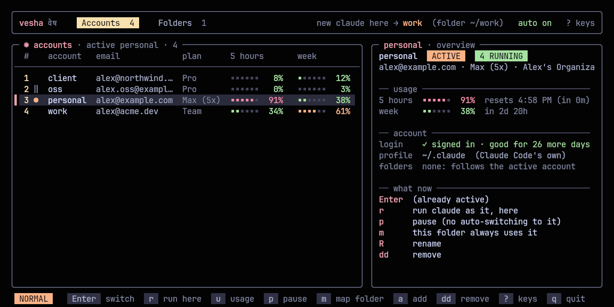
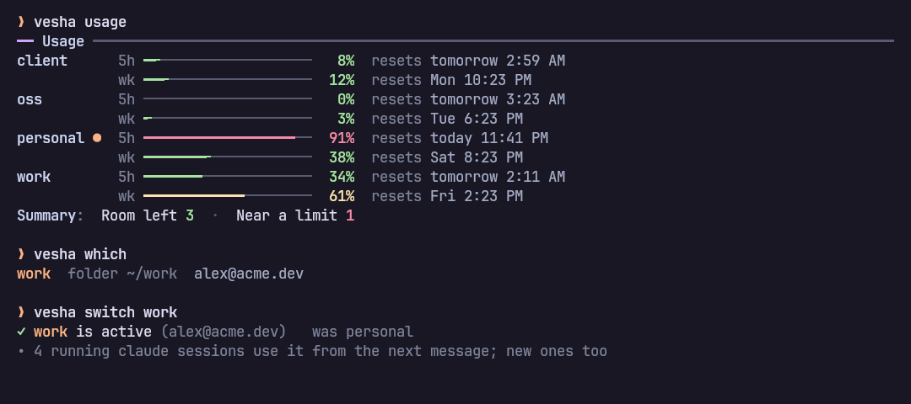
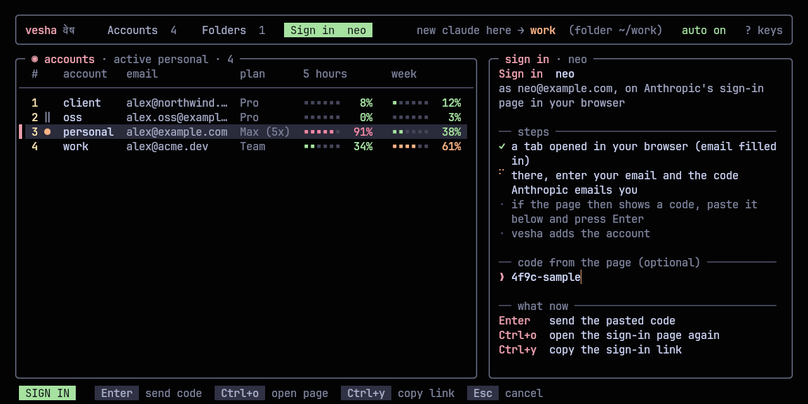
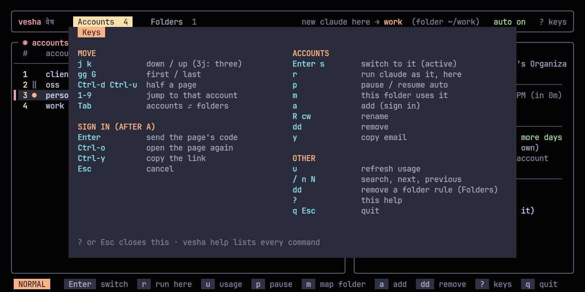

<p align="center">
  <picture>
    <source media="(prefers-color-scheme: dark)" srcset="assets/banner-dark.svg">
    <source media="(prefers-color-scheme: light)" srcset="assets/banner-light.svg">
    
  </picture>
</p>

<p align="center">
  <b>Every Claude Code account, one key away.</b><br>
  Switch the account plain <code>claude</code> uses, from any folder, see every account's limits at a glance, and let vesha switch for you when one runs out.
</p>

<p align="center">
  <a href="https://github.com/Theyashsawarkar/vesha/actions/workflows/ci.yml"></a>
  <a href="https://github.com/Theyashsawarkar/vesha/releases"></a>
  <a href="LICENSE"></a>
  
</p>

> *Vesha* (वेष) is Sanskrit for "guise, attire": the same Claude, wearing
> whichever account you choose.

You have more than one Claude subscription: a personal one, a work one,
maybe a client's. Claude Code signs in to one at a time, and when its
5-hour limit runs out mid-task you sign out, sign in to the other, and
lose your flow. **vesha** keeps every account signed in at once, each in
its own Claude Code profile, and decides which one a new `claude` starts
with. Switch with one key in the switcher or `vesha switch`; when the
active account reaches its limit, vesha switches to the one with the most
room left and tells you.

<p align="center">
  
</p>

## Contents

- [Features](#features)
- [Install](#install)
- [Getting started](#getting-started)
- [The switcher](#the-switcher)
- [Commands](#commands)
- [Automatic switching](#automatic-switching)
- [Which account a new claude uses](#which-account-a-new-claude-uses)
- [Configuration](#configuration)
- [Integrations](#integrations)
- [How it works](#how-it-works)
- [Coming from claude-swap](#coming-from-claude-swap)
- [Troubleshooting](#troubleshooting)
- [Contributing](#contributing)
- [License](#license)

## Features

- **Every account signed in at once**: each account is its own Claude Code
  profile; switching never signs anything out, and sessions already
  running keep going on their account.
- **Switch from anywhere**: `vesha switch work` (or one key in the
  switcher) changes the account every new `claude` uses, in every folder
  and every terminal. No restart, no re-login.
- **Automatic switching at the limit**: a small background watcher warns
  you near the limit (with a "Switch to …" button on the notification) and
  switches by itself when the active account runs out, to the account with
  the most room left.
- **Limits at a glance**: 5-hour and weekly usage for every account, with
  the time each resets, in the switcher, `vesha usage`, and your status bar.
- **Vim keys throughout**: `j`/`k`, `gg`/`G`, counts, `/` search, `dd`,
  `cw`, `?` for every key.
- **One setup, every account**: your CLAUDE.md, settings, skills, plugins,
  agents and commands are shared by every account, and so is your history,
  so `claude --resume` finds a conversation whichever account started it.
- **Optional folder rules**: `vesha map client ~/code/northwind` and that
  folder (and everything under it) always uses that account.
- **This terminal only**: `vesha use oss` switches just the current shell;
  `vesha run work -- claude -p "..."` runs one command as another account.
- **Imports claude-swap**: `vesha import cswap` brings its accounts across.
- **Safe with your logins**: only one copy of each login ever exists (Claude
  Code rotates them; copies would log each other out), files are private
  to you, and no token is ever printed.
- **No dependencies** beyond Python 3.11's standard library.

## Install

With [kosha](https://github.com/Theyashsawarkar/kosha):

```sh
kosha install vesha
```

Or with the installer, which clones vesha into `~/.local/share/vesha` and
links `~/.local/bin/vesha` (no root):

```sh
curl -fsSL https://raw.githubusercontent.com/Theyashsawarkar/vesha/main/install.sh | bash
```

Or by hand:

```sh
git clone https://github.com/Theyashsawarkar/vesha ~/.local/share/vesha
ln -s ~/.local/share/vesha/bin/vesha ~/.local/bin/vesha
```

**Requirements:** Linux, Python 3.11+, [Claude Code](https://docs.claude.com/en/docs/claude-code)
signed in with a Claude subscription (Pro, Max, Team or Enterprise).
Optional: `notify-send` for notifications, `wl-copy` to copy an email from
the switcher, systemd for the background watcher.

## Getting started

```sh
vesha add personal --current   # the account Claude Code is already signed in to
vesha add work                 # signs in another account (opens Claude Code's sign-in)
vesha install-shim             # plain `claude` now follows the active account
vesha service install          # the watcher: warns near limits, switches at them
eval "$(vesha init zsh)"       # in ~/.zshrc: `vesha use` and tab completion (or bash)
vesha doctor                   # checks all of it
```

Then `vesha` opens the switcher, and `vesha switch work` or `vesha switch`
(the next account) switches from the command line.

<p align="center">
  
</p>

## The switcher

`vesha` on its own opens it, laid out like
[sangam](https://github.com/Theyashsawarkar/sangam): tabs for accounts and
folder rules on top, with the account a new `claude` would use here; the
accounts on the left with both limits; the selected account's overview on
the right (usage with reset times, login, profile, folders, and what you
can do with it). Marks in the list: ● active, ‖ paused, ! login changed.

| Key | Does |
| --- | --- |
| `j` / `k` | Move down / up (counts work: `3j`) |
| `gg` / `G` | First / last account |
| `Ctrl+d` / `Ctrl+u` | Half a page down / up |
| `1-9` | Jump to that account |
| `Tab` | Between accounts and folder rules |
| `Enter` / `s` | Switch to the account |
| `r` | Run claude as the account, in this folder, just this once |
| `u` | Refresh usage now |
| `p` | Pause / resume (out of automatic switching) |
| `m` | This folder always uses the account |
| `a` | Sign in a new account, right here (see below) |
| `R` / `cw` | Rename the account |
| `dd` | Remove the account, or the folder rule (asks first) |
| `y` | Copy the account's email |
| `/`, `n` / `N` | Search; next / previous match |
| `?` | Every key |
| `q` / `Esc` | Quit |

### Signing in a new account

Press `a`, give the account a name and (optionally) its email. A tab opens
in your browser on Anthropic's sign-in page with the email filled in; enter
the code Anthropic emails you there. If the page then shows a code, paste it
into vesha and press Enter. The account is added and selected; `Enter`
makes it active. vesha runs Claude Code's own sign-in for the new profile,
so it never handles a password.

| Key | Does |
| --- | --- |
| `Enter` | Send the code the sign-in page shows |
| `Ctrl+o` | Open the sign-in page again |
| `Ctrl+y` | Copy the sign-in link (to open it in another browser) |
| `Esc` | Cancel (the half-made profile is removed) |

From a shell: `vesha add work2 you@company.com`.

<p align="center">
  
</p>

<p align="center">
  
</p>

## Commands

Every command has `--help` with examples; `vesha help` lists them all.

| Command | Does |
| --- | --- |
| `vesha` | The switcher (without a terminal: the account list) |
| `vesha switch [name]` | Make an account the active one; no name: the next one (`sw`, `s`) |
| `vesha list` | Every account: plan, usage, which is active (`ls`, `status`) |
| `vesha usage` | Both limits of every account, with reset times (`u`) |
| `vesha which` | The account a new claude would use here, and why (`w`) |
| `vesha run <name> [-- cmd …]` | Run claude (or any command) as an account, once (`r`) |
| `vesha use <name>` | This terminal only (needs the shell hook) |
| `vesha auto on\|off` | Automatic switching at the limit |
| `vesha pause <name>` / `resume` | Keep an account out of automatic switching |
| `vesha add <name> [email] [--current]` | Sign in a new account (browser, email filled in), or adopt the current one (`login` signs in again) |
| `vesha repair` | Fix profiles whose login another tool replaced (`fix`) |
| `vesha remove <name>` | Forget an account and delete its profile (`rm`) |
| `vesha rename <old> <new>` | Rename an account (`mv`) |
| `vesha import cswap` | Bring your claude-swap accounts across |
| `vesha map <name> [folder]` / `unmap` | Optional folder rules |
| `vesha install-shim` / `uninstall-shim` | The `claude` wrapper |
| `vesha service install\|remove\|status` | The background watcher (systemd user unit) |
| `vesha init zsh\|bash` | The shell hook for `vesha use` and completion |
| `vesha doctor` | Check every account, the wrapper and the watcher (`check`) |
| `vesha waybar` | JSON for a waybar module |

Options: `-y` don't ask, `--json` (list, usage, which), `--no-color`
(also `NO_COLOR=1`), `-h`, `-V`.

## Automatic switching

`vesha service install` starts `vesha.service`, a systemd user unit that
checks the active account's usage every two minutes (every minute once
it's close):

- At **85%** of either limit it notifies you once per window, with a
  **Switch to …** button naming the account with the most room.
- At **98%** it switches the active account to that account and tells you
  which one, and when the old one resets. New `claude` sessions use it
  everywhere; a session that hit the limit continues on the new account
  when you restart it (`claude --continue`: the history is shared).
- If every account is at its limit, it tells you when the first one resets.

"Most room" means the lowest of each account's worse window (a 5-hour
limit at 20% doesn't help if the week is at 95%). Paused accounts, and
accounts whose usage couldn't be checked, are never picked. `vesha auto
off` keeps the warnings and stops the switching; the log is
`~/.local/state/vesha/watch.log`.

## Which account a new claude uses

In this order, first match wins:

1. `VESHA_ACCOUNT` in the environment: `vesha use` and `vesha run` set it
   for one terminal or one command.
2. A folder rule (`vesha map`): the closest rule above the current folder.
3. The **active** account: the one `vesha switch` (and the watcher) set.

`vesha which` prints the answer and the reason for the current folder.
Folder rules are optional; without any, every folder follows the active
account.

## Configuration

`~/.config/vesha/config.toml` (every key optional):

```toml
warn_at = 85         # notify at this % of either limit
switch_at = 98       # switch the active account at this %
auto = true          # switch automatically (else only notify)
share_history = true # every account shares conversations, todos, plans
usage_ttl = 180      # seconds to reuse fetched usage
check_every = 120    # seconds between the watcher's checks
```

## Integrations

**tmux**: a popup on a key:

```tmux
bind -N "Switch Claude Code account (vesha)" C display-popup -E -w 80% -h 70% vesha
```

**waybar**: the active account and its 5-hour usage, every account in the
tooltip; click for the switcher, scroll to switch. `vesha waybar` keeps
running and redraws the moment the account changes:

```jsonc
"custom/vesha": {
  "exec": "vesha waybar",
  "return-type": "json",
  "on-click": "kitty --class vesha -e vesha",
  "on-scroll-up": "vesha switch",
  "on-scroll-down": "vesha switch"
}
```

The JSON's `class` is `ok`, `warn`, `full` or `unknown` for styling. It
hides itself with fewer than two accounts.

**Scripts**: `vesha list --json`, `vesha usage --json` and `vesha which
--json`; exit codes are 0 (fine), 1 (failed) and 2 (bad usage).

## How it works

- **One profile per account.** The account already in `~/.claude` stays
  there; each other one gets `~/.local/state/vesha/profiles/<name>`, which
  Claude Code uses through `CLAUDE_CONFIG_DIR`. Your setup (CLAUDE.md,
  settings, skills, plugins, agents, commands, output styles, keybindings)
  is linked into every profile from `~/.claude`, and with `share_history`
  so are your projects, history, todos, file history and plans.
- **The wrapper.** `vesha install-shim` puts a small `claude` in
  `~/.local/bin` that asks vesha which account applies and runs the real
  Claude Code with that profile. It adds a few milliseconds.
- **One copy of each login.** Claude Code rotates its login tokens, so
  vesha never copies them: each login lives only in its profile. To read
  usage, vesha calls the same endpoint Claude Code's `/usage` does, renewing
  an expired token itself only when no Claude Code is running on that
  profile.
- **State** is `~/.local/state/vesha/accounts.json` (names, which is
  active, folder rules; private to you), usage is cached in
  `~/.cache/vesha`.

## Coming from claude-swap

```sh
vesha import cswap      # every claude-swap account, with its login
vesha list              # check them; rename with: vesha rename <old> <new>
```

The account signed in to `~/.claude` becomes vesha's main account; the
others get their own profiles. Once vesha works for you, remove claude-swap
(`uv tool uninstall claude-swap` or however you installed it): switching
with both would fight over `~/.claude`.

## Troubleshooting

Start with `vesha doctor`: it checks Claude Code, the wrapper, the watcher
and every login, and prints the command that fixes each problem.

- **`claude` ignores the switch**: another `claude` comes first on your
  PATH. `vesha doctor` says which; put `~/.local/bin` first.
- **Two accounts show the same usage, or "login changed"**: another tool
  (claude-swap, a `/login` inside Claude Code) replaced a profile's login,
  usually `~/.claude`'s, with another account's. `vesha repair` shows what it
  will fix and asks; then `vesha login <name>` signs the account that lost
  its login in again. Uninstall claude-swap so it can't happen again.
- **An account shows "signed out"**: its login expired or was revoked.
  `vesha login <name>` signs it in again.
- **Usage shows "token renewing in Claude"**: Claude Code is running on that
  account and will renew its token itself; the last known numbers are shown
  meanwhile.
- **No notifications**: install `libnotify` (`notify-send`) and a
  notification daemon; `vesha service status` shows the watcher's log.

## Contributing

Issues and pull requests are welcome: see [CONTRIBUTING.md](CONTRIBUTING.md).
Design decisions are recorded in [docs/adr](docs/adr). Security issues:
[SECURITY.md](SECURITY.md).

## License

[MIT](LICENSE). Not affiliated with Anthropic; Claude and Claude Code are
Anthropic's.
